# State available to authenticated users

These flowcharts describe the relationship between source atoms, derived atoms, remote atoms, and persistent storage.
An arrow points from an atom to what it reads; a parallelogram is an API call. Every exported atom is drawn; a helper
atom a module keeps to itself (a stored or remote atom inside a family, an override, a filter step) is drawn as part of
the exported atom that owns it. An atom with no arrow lives in memory only. The public atoms these read (`userAtom`,
`validIdTokenAtom`, ...) are drawn in [the public state README](../../state/README.md).

The reference collections (email templates, event types, judges, locations, officials, organizers, users) are built
with `atomWithCachedRemoteCollection` and cached in an encrypted IndexedDB store; when they are fetched and how a write
reaches the cache is in [cached/README.md](cached/README.md). In each graph such a collection reads `userAtom` and
`validIdTokenAtom` and stores into `indexedDB`.

Derived atoms that combine state from multiple admin domains live in the parent `derivedAtoms.ts` module. Feature folders own
their source, editable, remote, and derived atoms alongside actions for that domain.

## Writes go through actions

A component never calls a write in `src/api` itself: it calls an action (`useAdminEventActions`,
`useAdminRegistrationActions`, `useSaveEventResults`), and the action calls the API and stores what
came back in the atoms. That is what keeps the screen that wrote showing what it wrote without
waiting for its own change to come back over the socket, and what keeps the cached and the stored
state the same thing (KOE-1343). A read that touches no atom may call the API
directly: an audit trail, a token link, a search. An actions hook subscribes to nothing asynchronous and needs no router:
it reads the selected event, the calendar and the user through `useAtomCallback` when an action
runs, so any view can hold it without suspending, and navigation after an action is the view's.

## Event scope

The families keyed by an event (`adminEventAtom`, `adminEventRegistrationsAtom`, the editable
copies, ...) hold one instance per event ever opened. Every page that opens an event claims it with
`useAdminEventScope(eventId)`; a moment after the last such page unmounts, `releaseAdminEventAtoms`
drops the event's instances from every family, and the next visit builds them again from storage and
the server. A family keyed by an event and one more key (a registration's id, or the view a draft is
for) is released by `releaseEventKeyed`, which walks its `getParams()` for the event's id. Add a new
event-keyed family to `eventScope.ts`, or it leaks.

`rereadHeldAdminEventsAtom` is write-only: after the socket has been away it runs `adminEventsRereadAtom`
and, for every held event, `adminEventRegistrationsReloadAtom` and a bump of
`adminDuplicatePaymentsRefreshAtom`. It reports a read that failed, which then waits for the next
reconnect. When it runs is in [the ws README](../../../lambda/lib/ws/README.md).

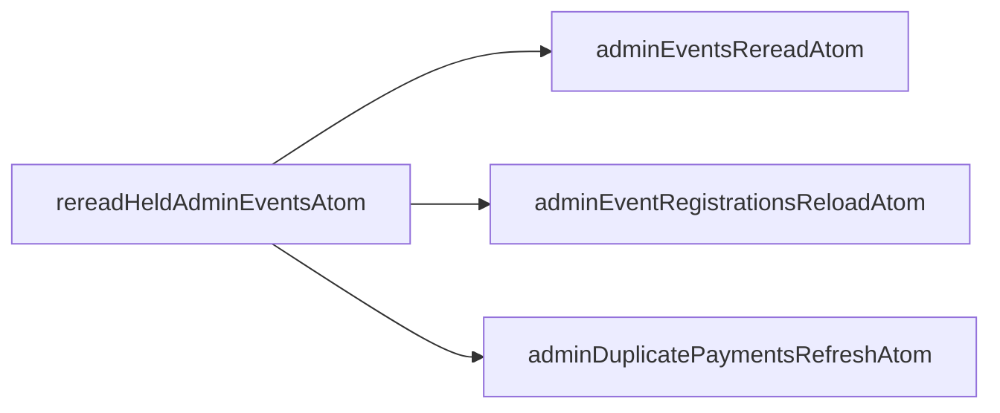

## Event view dialogs

`adminEventViewDialogAtom` (`eventViewDialog.ts`) holds which of the event page's dialogs is open,
and what it was opened for. The page renders the dialogs; the buttons that open them are in the entry
lists and the info panel, and call `useOpenEventViewDialog()` instead of receiving a setter through
every component in between (KOE-1347).

## Across domains

The parent `derivedAtoms.ts` combines the events, the organizers and the users with the signed-in user's roles: what
the event list, the organizer list and the organizer pickers offer to this user.

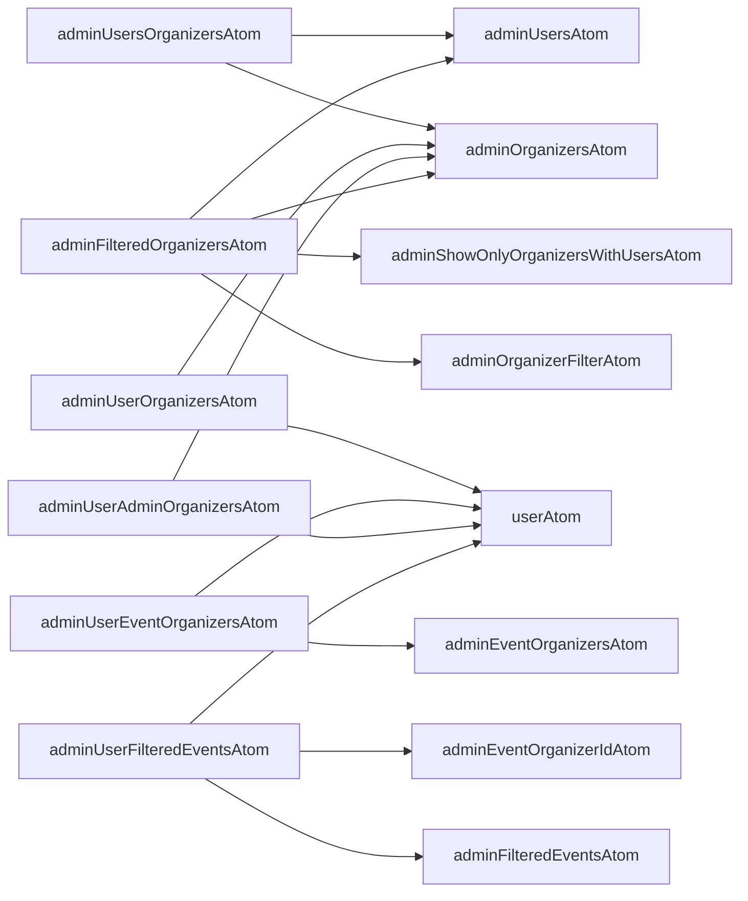

## Email templates

`adminEmailTemplatesAtom` is `adminEmailTemplatesRemoteAtom` under a second name, a cached collection
([cached/README.md](cached/README.md)) that always holds a template for every id the code knows, an empty one if the
table has none yet. `adminEditableTemplateByIdAtom(templateId)` is the template being edited, kept in this tab;
`useAdminEmailTemplatesActions().save` stores it with `putEmailTemplate`.

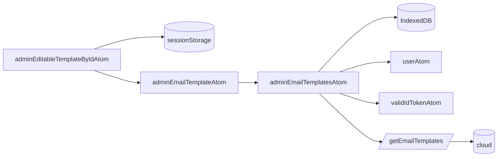

## Events

`adminEventsAtom` is `adminEventsRemoteAtom` under a second name, the `(eventId)` atoms are families
keyed by the event, and `adminEditableEventByIdAndFormAtom` is keyed by the event and the view. The
fetched list is kept in sessionStorage (`adminEvents`, with the user's id, admin flag and roles under `adminEvents:scope`), and the next
fetch in the same tab with the same scope asks `getAdminEvents` only for the events changed since the
newest stamp in it, merged by id. A local write (a save, a websocket patch) is not kept: the server
stamps it, so the next fetch brings it. A change of roles or user fetches the whole list again, and
signing out clears the storage (KOE-1668). `adminEventsRereadAtom` is write-only: the same read for a
socket that was away, written over the list without moving the fetch key, so a failure leaves the list
as it is and only rejects to its caller; a row in hand with a newer stamp stays (`keepNewerRows`), and
the answer is dropped if the key moved during the read (KOE-1698).

`adminEditableEventByIdAndFormAtom({ eventId, form })` is the draft of one view of a stored event in
sessionStorage (`adminEditableEvent/<form>/Id__<eventId>`): the edit page, the stations page, the
teams page (KOE-1714) and the event view's details dialog each edit their own, so a change left on one
never turns up in another (KOE-1700). A view that opens on a draft whose `modifiedAt` is not the stored
event's drops it once (`isStaleEventDraft`), since the draft was begun before the last save; a save that
comes while the view is open leaves its change alone. An event gone from the list keeps the draft, which
is then all there is of it. The details dialog mounts its form only while open, and Esc and a click
outside discard its draft as Cancel does. The stations and teams pages leave none behind: leaving
unsaved asks, and the answer to leave discards that page's draft (KOE-1699). A new event has one draft,
`adminNewEventAtom`. `adminSaveEventAtom` is write-only: after the read and the call shown here, it
writes `adminEventIdAtom`, `adminCurrentEventAtom` and the public `eventsAtom`.

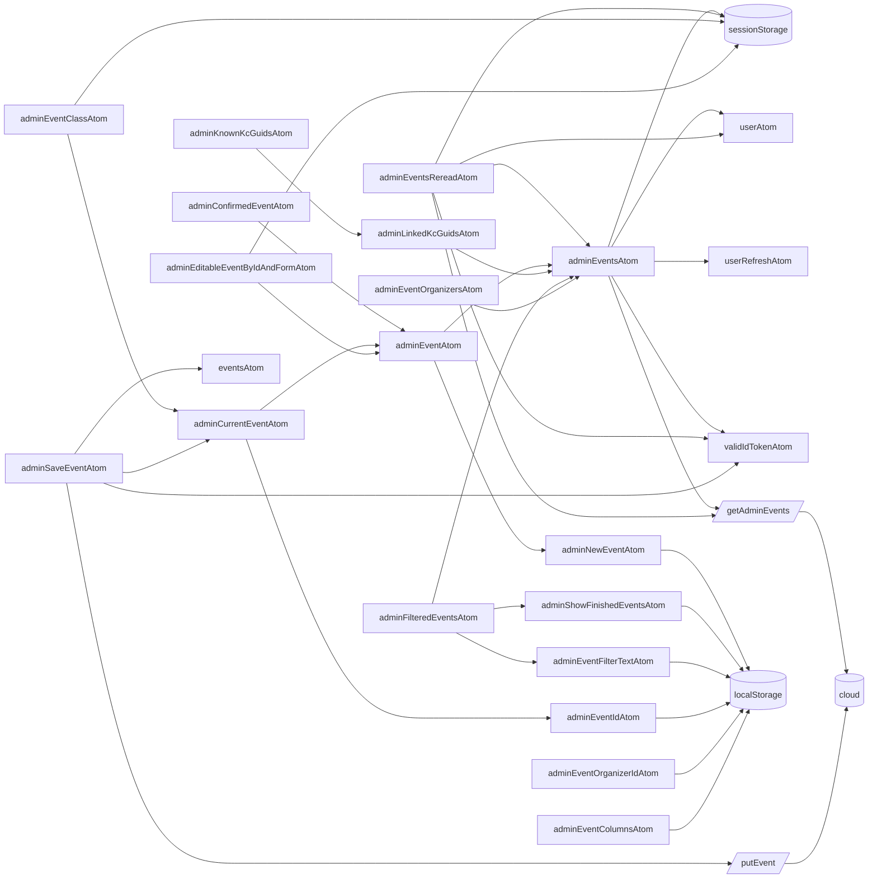

## Event types

`adminEventTypesAtom` is `adminEventTypesRemoteAtom` under a second name, a cached collection
([cached/README.md](cached/README.md)). `adminEventTypeClassesAtom` and `adminEventTypeGroupsByTypeAtom` are constant
tables, the classes and the registration times each event type offers (the classes are `EVENT_TYPE_CLASSES` of
`src/lib/event.ts`, which the rule of a followed type's classes reads too); `adminEventTypeGroupsAtom(eventType)` picks
the times of one type, with the unofficial events' times for a type that is not official. Its readers pass the
event's format, `formatTypeOf(event)`, so an unofficial trial that follows an official type gets that type's times
(KOE-1718).

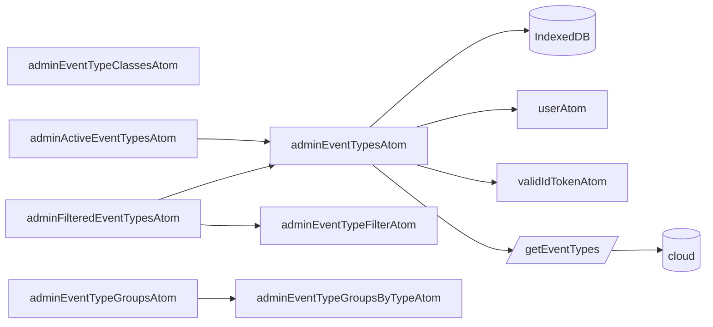

## Judges

`adminJudgesAtom` is `adminJudgesRemoteAtom` under a second name, a cached collection
([cached/README.md](cached/README.md)) built like the officials' list. `useAdminJudgesActions().refresh` refetches it
and the users with it.

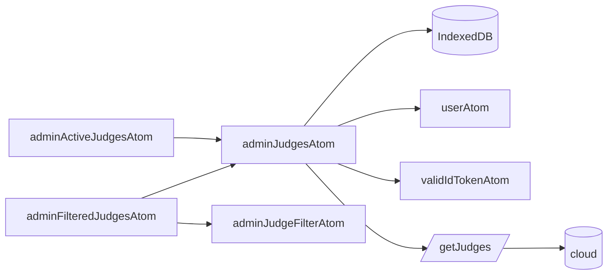

## Locations

The municipalities the event form suggests for the location. `adminLocationsAtom` is `adminLocationsRemoteAtom` under a
second name, a cached collection ([cached/README.md](cached/README.md)); `adminLocationNamesAtom` is their names, and
an empty list when the fetch fails, since the field is free text either way.

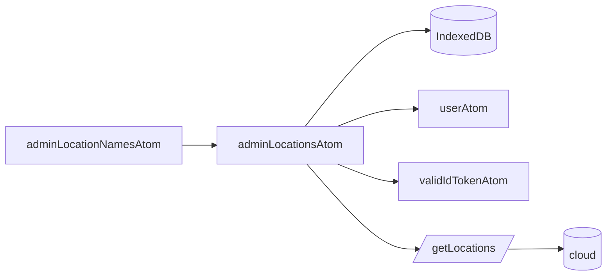

## Officials

`adminOfficialsAtom` is `adminOfficialsRemoteAtom` under a second name, a cached collection
([cached/README.md](cached/README.md)). `useAdminOfficialsActions().refresh` refetches it and the users with it.

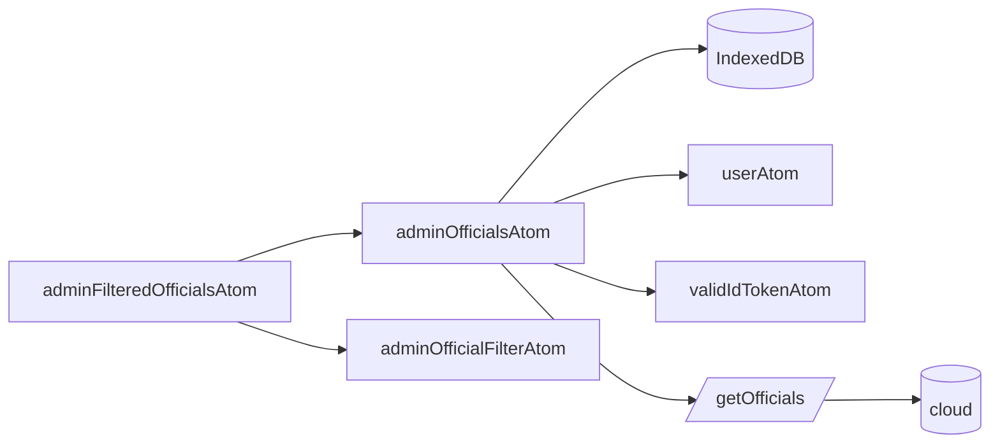

## Organizers

`adminOrganizersAtom` is `adminOrganizersRemoteAtom` under a second name, a cached collection
([cached/README.md](cached/README.md)). `adminFilteredOrganizersAtom`, which also reads the users, is drawn under
[Across domains](#across-domains).

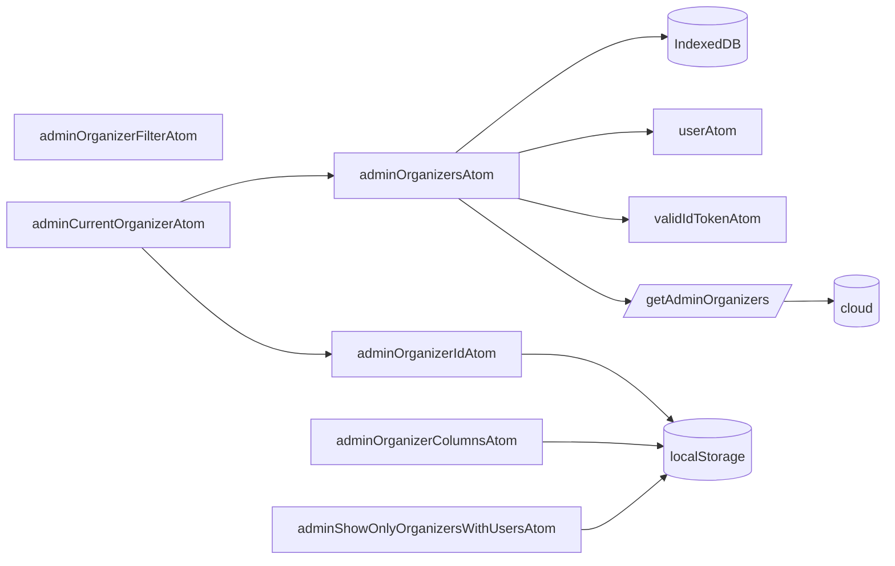

## Registrations

The `(eventId)` atoms are families keyed by the event, and `adminEventRegistrationAtom` and the
editable copy by the event and the registration. `adminBackgroundActionsRunningAtom`,
`adminEventRegistrationsFetchedAtAtom` and `adminEventRegistrationsCursorAtom` are plain in-memory
atoms that the registration actions write. `adminEventRegistrationsReloadAtom` is write-only and takes
the event id: it reads the whole list for a refused save and for a socket that was away, keeps a held
row with a newer stamp (`keepNewerRows`), and drops the answer if the token changed during the read. It
takes the list's instance before the read, so an answer after a release cannot recreate it with this
user's rows for the next login. It neither reads nor moves the cursor (KOE-1698).
`adminDuplicatePaymentsAtom` is the event's payments charged twice, a list of its own that reads again
when `adminDuplicatePaymentsRefreshAtom` is bumped (KOE-1693).

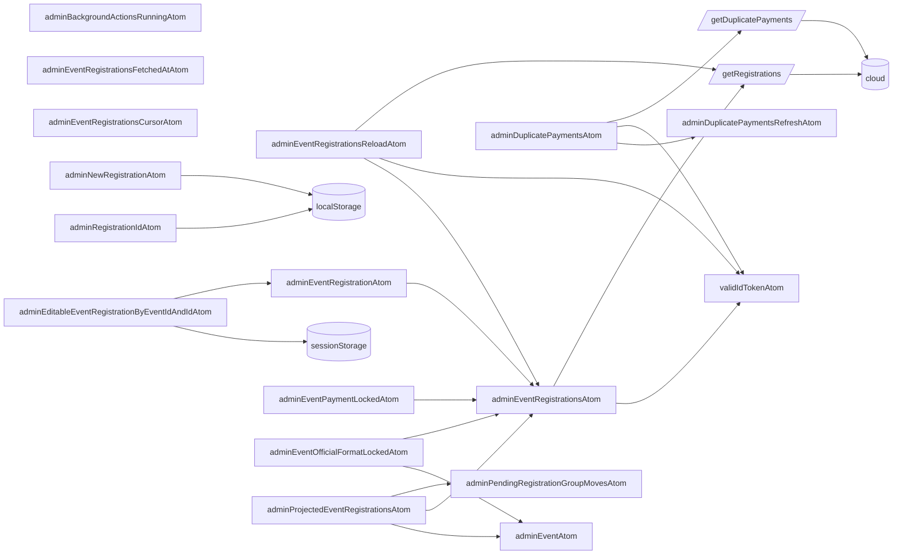

## Stats

The admin statistics page. `adminStatsYearAtom`, `adminStatsOrganizerIdAtom` and `adminCapacityStatsEventTypeAtom` are
its pickers. `adminOrganizerEventStatsAtom` fetches every organizer's event stats once and the page filters them;
`adminCapacityStatsAtom` is keyed by `eventType|organizerId` and `adminJudgeWorkloadAtom` by `year|organizerId`, so a
change of either picker fetches again. With the event type `ALL`, `adminCapacityStatsAtom` fetches every active event
type and merges them.

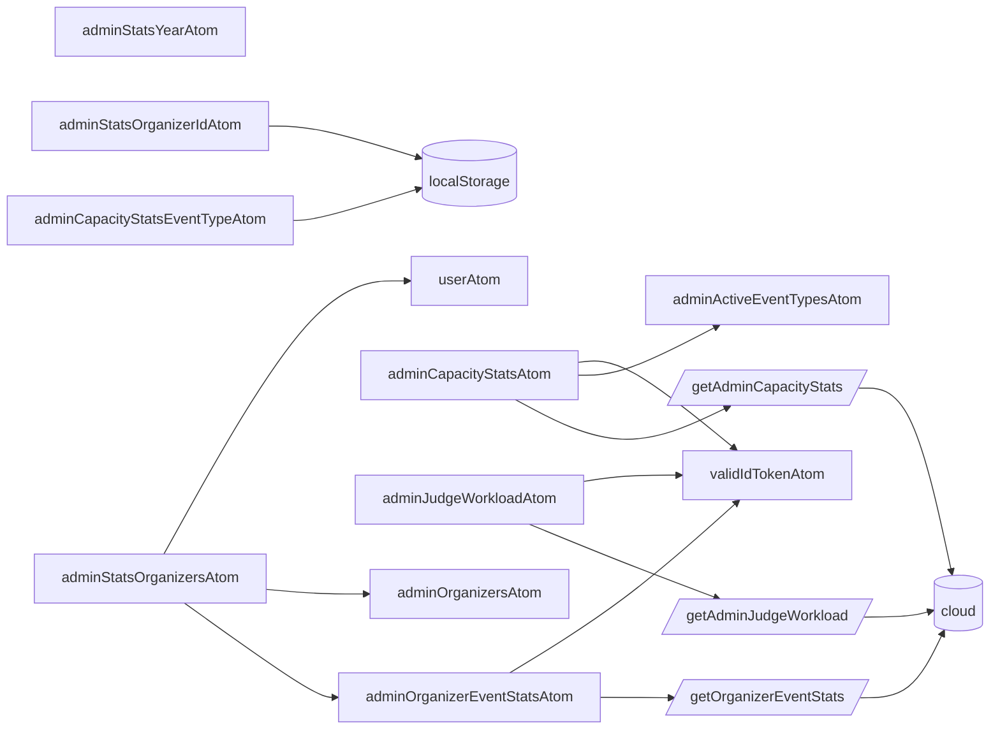

## Users

`adminUsersAtom` is `adminUsersRemoteAtom` under a second name, a cached collection
([cached/README.md](cached/README.md)). The users page refreshes it for `lastSeen` at most once per interval, and
`adminUsersRefreshedAtAtom` records when, in memory only so a reload forces it. `websocketAdminUsersAtom` is the list
`useWebSocket` names an event's other viewers from, and empty for a user who may not read the users.

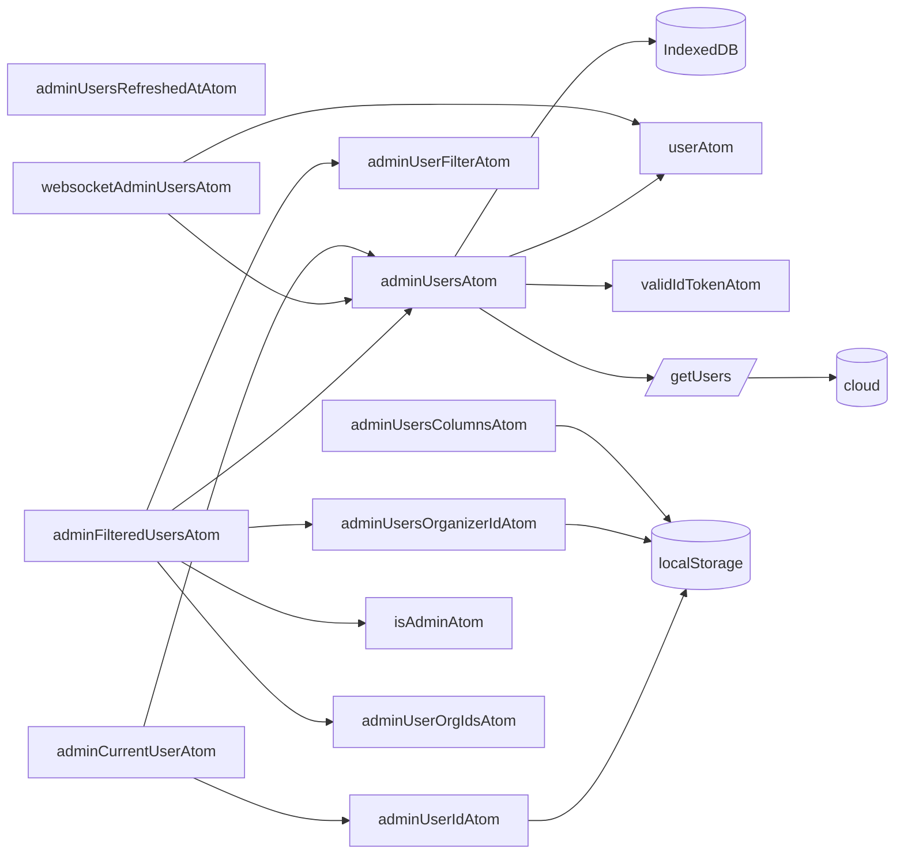
