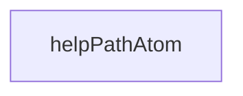
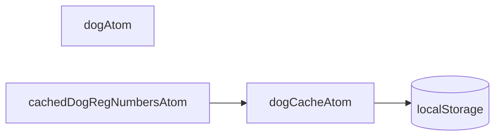
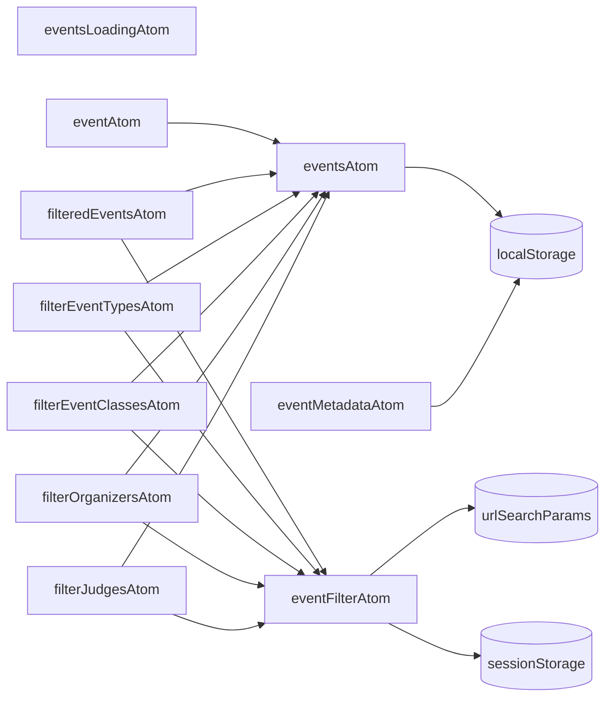
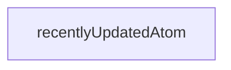
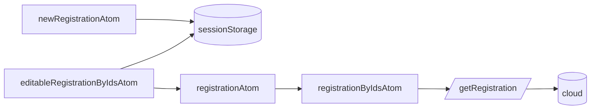
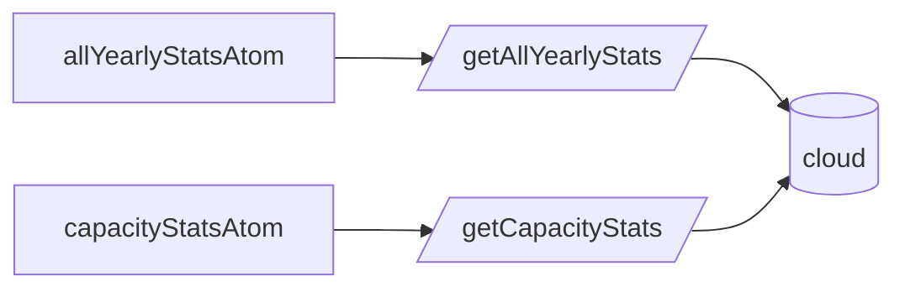
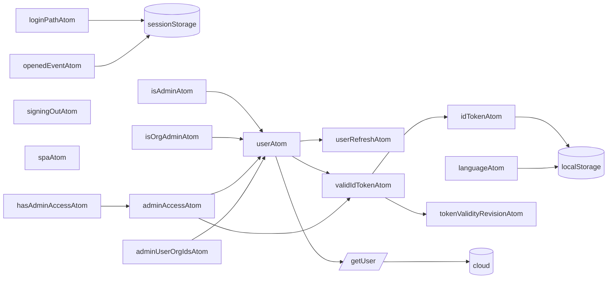

# State available to everyone

These flowcharts describe the relationship between source atoms, derived atoms, remote atoms, and persistent storage.
An arrow points from an atom to what it reads; a parallelogram is an API call. Every exported atom is drawn; a helper
atom a module keeps to itself (a stored or remote atom inside a family, a filter step) is drawn as part of the
exported atom that owns it. An atom with no arrow lives in memory only.

`loadedAtom(remote)` (`loadedAtom.ts`) is not state of its own but the wrapper the remote atoms here and in
`src/pages/admin/state` use: the first load is the fetch's own Promise, and every later load serves the last settled
value until the new one has settled, so a mounted page never suspends on data it already has.

## Help path

`helpPathAtom` (`docs.ts`) is the guide page the current view claims with `useHelpPath(path)`, for a view whose route
alone cannot name it. Unset, the header falls back to the route.

## Dog

The dog form's lookups. `dogAtom(registrationNumber)` holds the dog `useDogActions` fetched with `getDog`, and
`dogCacheAtom` keeps what the user entered for each dog (handler, owners, results) so the next registration starts
from it.

## Events

The public calendar. `eventsAtom` and `eventMetadataAtom` are the stored copy and its sync bookkeeping; nothing here
fetches by itself: `useFetchEvents()` (`hooks.ts`) calls `getEvents` and `getEvent` and writes `eventsAtom`,
`eventMetadataAtom` and `eventsLoadingAtom`. The filter lives in the URL's search parameters and is mirrored to
sessionStorage, so a return to the calendar restores it. Each `filter*Atom` offers the choices that the other filters
still leave: `matchesEventFilter` (`events/filters.ts`) applies the whole filter, or all of it but one facet.

## Recent updates

`recentlyUpdatedAtom` holds when each record was last changed by a background update, keyed by scope and id. How to
mark and highlight one is in [recentUpdates/README.md](recentUpdates/README.md).

## Registration

The participant's own registration. `registrationByIdsAtom` is keyed by `eventId:registrationId[:editToken]` and
fetches with `getRegistration` until something is written over it; `registrationAtom(id)` is the same thing for an
optional key. `newRegistrationAtom` is the draft of a new registration and `editableRegistrationByIdsAtom` the edited
copy of a saved one; both stay in this tab only. `useRegistrationActions` (`actions.ts`) saves them.

## Stats

The public statistics page. Both fetch once, without a token.

## User

The signed-in user. `idTokenAtom` is the stored token and `validIdTokenAtom` the same token while it is valid;
`useAuthSessionRefresh` bumps `tokenValidityRevisionAtom` so an expired token is noticed. `userAtom` fetches the user
through `getCurrentUser` (`getUser`), again whenever `userRefreshAtom` is bumped. `adminAccessAtom` is what an admin
page does with the visitor (`adminAccessOf` in `src/lib/user.ts`): `signedOut` goes to login, `denied` (no admin flag,
no organizer role) and `unavailable` (a valid token whose user could not be loaded) get a message from
`AdminAccessGuard`, `granted` gets the page; it suspends while the user loads. `hasAdminAccessAtom`, the header's
admin buttons, is the same answer as a boolean. `signingOutAtom` is set by a sign-out and cleared by the next sign-in:
the admin page a sign-out leaves does not send the user to login on its way to the front page. `languageAtom` is the UI language,
`loginPathAtom` where to return after signing in, `openedEventAtom(eventId)` whether an event is expanded in the
calendar, and `spaAtom` whether the search page has been shown in this load, so a registration page can offer "back to
search" instead of a link home.

